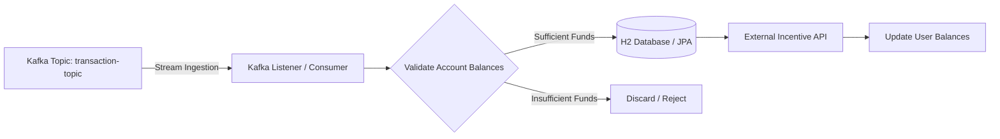

# 🏛️ JPMC Midas Core — Real-Time Transaction Processing Engine


Backend transaction processing core implemented for the **JPMorgan Chase & Co. Advanced Software Engineering Virtual Experience Program** (via Forage).

Midas Core processes high-throughput financial transactions stream-delivered via **Apache Kafka**, validates account balances, manages persistent balances in an **H2 in-memory database** via **Spring Data JPA**, and queries external microservices for transaction incentives.

---

## 🏗️ Architecture & Data Pipeline



---

## 🛠️ Key Components & Responsibilities

| Component | Class | Description |
|---|---|---|
| **Entity** | `UserRecord` | JPA entity mapping user account IDs to names and financial balances. |
| **Foundation** | `Transaction` | Financial transaction payload carrying sender ID, recipient ID, and amount. |
| **Foundation** | `Balance` | Current account balance representation returned to client queriers. |
| **Repository** | `UserRepository` | Spring Data JPA CrudRepository managing user persistence and balance updates. |
| **Conduit** | `DatabaseConduit` | Abstraction layer isolating business logic from direct repository operations. |
| **Incentive API** | `services/transaction-incentive-api.jar` | Standalone microservice evaluating promotional incentives on transactions. |

---

## 🚀 Getting Started

### 1. Prerequisites
- **Java**: JDK 17+
- **Maven**: 3.8+

### 2. Build the Project
```bash
# Compile and test foundation classes
mvn test-compile
```

### 3. Run Application
```bash
mvn spring-boot:run
```

The application boots on port `8080` with H2 console accessible at `http://localhost:8080/h2-console`.

---

## 📂 Project Structure

```
forage-midas/
├── .github/workflows/
│   └── ci.yml                          # Continuous integration workflow
├── src/
│   ├── main/java/com/jpmc/midascore/
│   │   ├── MidasCoreApplication.java   # Spring Boot bootstrap
│   │   ├── component/
│   │   │   └── DatabaseConduit.java    # Persistence abstraction
│   │   ├── entity/
│   │   │   └── UserRecord.java         # JPA entity for user accounts
│   │   ├── foundation/
│   │   │   ├── Transaction.java        # Kafka transaction payload
│   │   │   └── Balance.java            # Balance value object
│   │   └── repository/
│   │       └── UserRepository.java     # Spring Data repository
│   └── test/java/com/jpmc/midascore/
│       ├── foundation/
│       │   ├── TransactionModelTest.java # Unit tests for transactions & users (4 tests)
│       │   └── MidasTestRunner.java      # Standalone test runner
│       └── TaskOneTests.java           # Program verification suites
├── services/
│   └── transaction-incentive-api.jar   # Bundled incentive evaluation microservice
├── application.yml                     # H2, JPA & Kafka configurations
├── pom.xml                             # Maven build configuration
└── .gitignore                          # Maven & IDE ignores
```

---

## 📄 License

Distributed under the MIT License. See `LICENSE` for more information.
